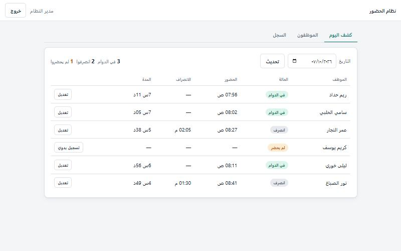
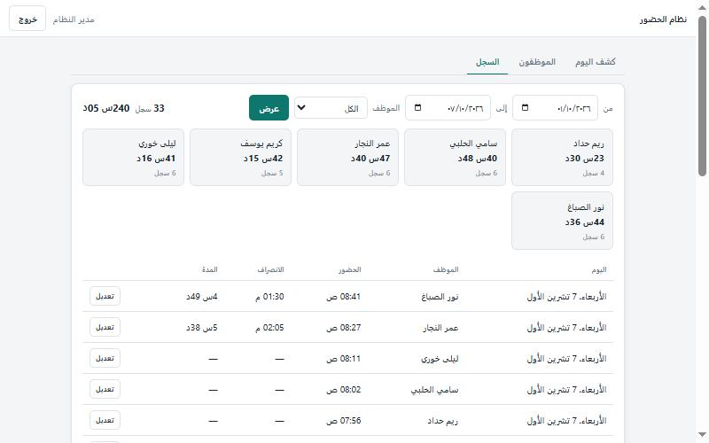
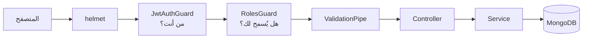

# نظام الحضور

[English](README.md) | **العربية**


نظام ويب صغير يحلّ محلّ ورقة الحضور. الموظف يضغط زرًّا عند القدوم وزرًّا عند الانصراف، والخادم يسجّل الوقت. الإدارة ترى من في الدوام ومن انصرف ومن لم يحضر، وتصحّح السجل حين ينسى أحدهم.

مبنيّ بـ NestJS و MongoDB، مع واجهة HTML/JS بلا مكتبات يخدّمها الخادم نفسه.

## لقطات

| الموظف | الإدارة: كشف اليوم |
|---|---|
|  |  |

| الإدارة: السجل والمجاميع |
|---|
|  |

## المزايا

**للموظف**

- تسجيل الحضور والانصراف بزر واحد يتبدّل حسب حالة اليوم.
- ساعة حيّة تعرض وقت الخادم، والمدة المنقضية في الدوام.
- سجله الشخصي مع فلترة بيوم أو بفترة ومجموع الساعات.

**للإدارة**

- **كشف اليوم:** كل موظف فعّال في صفحة واحدة، حضر أم لم يحضر، ولأي تاريخ.
- **السجل:** فلترة بيوم أو بفترة أو بموظف، مع مجموع ساعات العمل لكل موظف.
- **أيام العطلة الأسبوعية:** عطلة افتراضية للشركة من تبويب الإعدادات (الجمعة والسبت)، ولكل موظف أيام خاصة به من تبويب الموظفين إن اختلفت عطلته. سجلات هذه الأيام تبقى ظاهرة لكنها خارج مجموع الساعات وملف Excel، وكشف اليوم لا يعدّ أحدًا غائبًا فيها.
- **تصدير Excel:** ملف لكل موظف عن فترة تختارها، فيه الحضور والانصراف والمدة والملاحظات لكل يوم، وفي آخره مجموع الساعات.
- **التصحيح اليدوي:** إضافة سجل لمن نسي أو تعديل سجل موجود، وكل تصحيح يُحفظ معه من أجراه ومتى.
- **الحسابات:** إنشاء الموظفين، إعادة تعيين كلمات المرور، التعطيل وإعادة التفعيل.

**في الأساس**

- الوقت من الخادم دائمًا. مسار الحضور لا يقرأ أي جسم للطلب، ومسار الانصراف يقبل فقط ملاحظة اختيارية `note` (500 حرف كحد أقصى) تظهر للإدارة في كشف اليوم والسجل.
- سجل واحد للموظف في اليوم، يفرضه فهرس فريد في القاعدة، فلا تكرار مع الضغط المزدوج أو الطلبات المتزامنة.
- صلاحيات حسب الدور (مدير / موظف) عبر JWT، وكل مسار محمي ما لم يُعلَن أنه عام.
- تعطيل الحساب يسري من الطلب التالي، لا عند انتهاء التوكن.
- تسجيل الدخول محدود بخمس محاولات في الدقيقة لكل عنوان IP.
- يوم العمل يُحسب بمنطقة زمنية قابلة للضبط، مستقلة عن ساعة الخادم.

## التقنيات

| الطبقة | الاختيار |
|---|---|
| الإطار | NestJS 12 (ES modules) |
| قاعدة البيانات | MongoDB مع Mongoose 9 |
| المصادقة | Passport JWT و bcrypt |
| التحقق من المدخلات | class-validator و class-transformer |
| الأمان | helmet و ‎@nestjs/throttler |
| الاختبارات | Vitest و Supertest |
| الواجهة | HTML و CSS و JavaScript بلا خطوة بناء |

## التشغيل

**المتطلبات:** Node.js 24 وخادم MongoDB (محلي أو Atlas).

```bash
git clone https://github.com/Bashar-m/attendance-api.git
cd attendance-api
npm install
```

انسخ `.env.example` إلى `.env` واملأ القيم:

| المتغيّر | الوصف |
|---|---|
| `MONGODB_URL` | رابط الاتصال بـ MongoDB |
| `MONGODB_DB` | اسم قاعدة البيانات |
| `PORT` | منفذ HTTP (الافتراضي `3000`) |
| `JWT_SECRET` | نص عشوائي طويل لتوقيع التوكن |
| `APP_TIMEZONE` | المنطقة الزمنية التي يُحسب بها يوم العمل (الافتراضي `Asia/Damascus`) |
| `ADMIN_USERNAME` | اسم مستخدم المدير الأول |
| `ADMIN_PASSWORD` | كلمة مرور المدير الأول |

لتوليد السرّ:

```bash
node -e "console.log(require('crypto').randomBytes(48).toString('hex'))"
```

التشغيل في وضع التطوير:

```bash
npm run start:dev
```

افتح `http://localhost:3000`. عند أول إقلاع، إن لم يوجد مدير في القاعدة، يُنشأ واحد من `ADMIN_USERNAME` و`ADMIN_PASSWORD`. ادخل به وأضف الموظفين من تبويب «الموظفون».

للإنتاج، ابنِ المشروع مرة ثم شغّل الناتج من جذر المشروع:

```bash
npm run build
npm run start:prod
```

## الـ API

كل المسارات تبدأ بـ `/api` وتحتاج الترويسة `Authorization: Bearer <token>`، إلا تسجيل الدخول.

| الطريقة | المسار | الدور | الوظيفة |
|---|---|---|---|
| `POST` | `/auth/login` | عام | يرجع `accessToken` وبيانات المستخدم |
| `GET` | `/auth/me` | أي مسجَّل | المستخدم الحالي |
| `POST` | `/users` | مدير | إنشاء موظف |
| `GET` | `/users` | مدير | قائمة المستخدمين |
| `PATCH` | `/users/:id` | مدير | تعديل الاسم، كلمة مرور جديدة، تفعيل / تعطيل، أيام عطلة خاصة (`weekendDays`، و`null` = الافتراضي) |
| `POST` | `/attendance/check-in` | موظف | تسجيل الحضور (بلا جسم) |
| `POST` | `/attendance/check-out` | موظف | تسجيل الانصراف؛ جسم اختياري `{ "note": "..." }` |
| `GET` | `/attendance/today` | موظف | سجل اليوم ووقت الخادم |
| `GET` | `/attendance/me` | موظف | سجلّه الشخصي |
| `GET` | `/attendance/daily` | مدير | كل موظف وسجله ليوم `?date=` (الافتراضي: اليوم) |
| `GET` | `/attendance` | مدير | السجلات مع الفلاتر والمجاميع |
| `POST` | `/attendance` | مدير | إضافة سجل يدويًّا |
| `PATCH` | `/attendance/:id` | مدير | تصحيح سجل |
| `GET` | `/settings` | مدير | أيام العطلة الافتراضية: `{ "weekendDays": [5, 6] }` (0 = الأحد … 6 = السبت) |
| `PATCH` | `/settings` | مدير | تغيير أيام العطلة الافتراضية |
| `GET` | `/attendance/export` | مدير | ملف Excel لموظف واحد: `?employee=<id>&from=YYYY-MM-DD&to=YYYY-MM-DD`، وفي آخره مجموع الساعات |

**الفلاتر** في `/attendance` و`/attendance/me`: ‏`from` و`to` (بصيغة `YYYY-MM-DD`)، `employee` (للمدير فقط)، `page`، `limit` (الحد الأعلى 100). `from` وحده يعني ذلك اليوم فقط، و`from` مع `to` يعني فترة.

**رموز الحالة:** `400` مدخلات غير صالحة، `401` توكن مفقود أو غير صالح، `403` دور غير مسموح أو حساب معطّل، `409` تكرار (حضور مسجَّل مسبقًا، اسم مستخدم مأخوذ)، `429` محاولات دخول كثيرة.

## البنية



```
src/
  main.ts            نقطة البداية
  app.setup.ts       إعدادات التطبيق، يشترك فيها التشغيل واختبار e2e
  app.module.ts      يجمع الموديولات ويفتح الاتصال بالقاعدة
  common/            ديكوريترات مشتركة: ‎@Public و ‎@Roles و ‎@CurrentUser
  users/             الحسابات وإنشاء المدير الأول
  auth/              تسجيل الدخول واستراتيجية JWT والحارسان
  attendance/        الحضور والانصراف وكشف اليوم والتصحيح
public/              الواجهة: index.html و style.css و app.js
test/                اختبار e2e
```

الكود مشروح بتعليقات عربية تبيّن سبب كل قرار، لا ما يفعله السطر.

## قرارات التصميم

| القرار | السبب |
|---|---|
| الوقت يضعه الخادم | الوقت القادم من العميل يمكن تزويره |
| الهوية من التوكن فقط | لا مسار يقبل معرّف الموظف من الموظف، فلا أحد يسجّل حضور زميله |
| فهرس فريد على `{employee, workDate}` | القاعدة ترفض التكرار في خطوة واحدة، أما «افحص ثم أدخل» فينكسر مع التزامن |
| `workDate` نص بالتوقيت المحلي | الأوقات تُخزَّن UTC، وحضور الساعة 01:30 يجب ألا يقع في اليوم السابق |
| الحارسان مسجَّلان على كل المسارات | نسيان `@Public()` يعطي 401 ظاهرًا، ونسيان الحارس يعطي ثغرة صامتة |
| الحسابات تُعطَّل ولا تُحذف | سجلات الحضور تبقى منسوبة لصاحبها |
| التعديل اليدوي يسجّل `editedBy` و`editedAt` | التصحيح يبقى مميَّزًا عن ضغطة الزر |

## الاختبارات

```bash
npm run test       # اختبارات الوحدة: حساب يوم العمل حول منتصف الليل
npm run test:e2e   # المسار الكامل عبر HTTP: الدخول، الأدوار، الحضور، التصحيح
```

اختبار e2e يحتاج خادم MongoDB متاحًا. يستخدم `MONGODB_URL` من `.env` لكنه يكتب في قاعدة مستقلة اسمها `attendance_e2e` ويحذفها عند الانتهاء.

## حدود معروفة

- سجل واحد للموظف في اليوم. الخروج والعودة في اليوم نفسه، والمناوبة التي تعبر منتصف الليل، غير مدعومَين.
- الحضور الذي لم يتبعه انصراف يُغلق تلقائيًّا عند بدء اليوم التالي، بوقت الحضور زائد ثانية واحدة. وقت الانصراف الحقيقي تُدخله الإدارة.
- لا قيد على مكان التسجيل؛ الموظف يستطيع التسجيل من أي مكان.
- الواجهة تعرض الأوقات بتوقيت جهاز المتصفح، والمفترض أنه يطابق `APP_TIMEZONE`.
- تحديد المحاولات يعتمد على عنوان IP. خلف reverse proxy يجب ضبط `trust proxy` في Express وإلا تشارك الجميع حدًّا واحدًا.
