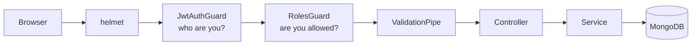

# Attendance System

**English** | [العربية](README.ar.md)


A small web system that replaces the paper attendance sheet. Employees press one button when they arrive and one when they leave; the server records the time. Managers see who is in, who has left and who has not shown up, and can correct records when someone forgets.

Built with NestJS and MongoDB, with a dependency-free HTML/JS front end served by the same server. The interface is in Arabic (RTL).

## Screenshots

| Employee | Admin: daily sheet |
|---|---|
|  |  |

| Admin: records and totals |
|---|
|  |

## Features

**Employees**

- Check in and check out with a single button; the button changes with the state of the day.
- A live clock showing server time, and the time worked so far.
- Their own history, filterable by day or date range, with total hours.

**Managers**

- **Daily sheet:** every active employee on one page, present or not, for any date.
- **Records:** filter by day, date range or employee, with worked-hours totals per employee.
- **Manual corrections:** add a record for someone who forgot, or fix an existing one. Every correction is stamped with who made it and when.
- **Accounts:** create employees, reset passwords, deactivate and reactivate.

**Built in**

- Time always comes from the server; the check-in and check-out endpoints read no request body.
- One record per employee per day, enforced by a unique database index, so double clicks and concurrent requests cannot create duplicates.
- Role-based access (admin / employee) with JWT; every route is protected unless explicitly marked public.
- Deactivating an account takes effect on the next request, not when the token expires.
- Login is rate limited to 5 attempts per minute per IP.
- Work days are calculated in a configurable time zone, independent of the server's own clock.

## Tech stack

| Layer | Choice |
|---|---|
| Framework | NestJS 12 (ES modules) |
| Database | MongoDB with Mongoose 9 |
| Auth | Passport JWT, bcrypt |
| Validation | class-validator, class-transformer |
| Security | helmet, @nestjs/throttler |
| Tests | Vitest, Supertest |
| Front end | Plain HTML, CSS and JavaScript (no build step) |

## Getting started

**Prerequisites:** Node.js 24 and a MongoDB instance (local or Atlas).

```bash
git clone https://github.com/Bashar-m/attendance-api.git
cd attendance-api
npm install
```

Copy `.env.example` to `.env` and fill in the values:

| Variable | Description |
|---|---|
| `MONGODB_URL` | MongoDB connection string |
| `MONGODB_DB` | Database name |
| `PORT` | HTTP port (default `3000`) |
| `JWT_SECRET` | Long random string used to sign tokens |
| `APP_TIMEZONE` | IANA time zone used to decide the work day (default `Asia/Damascus`) |
| `ADMIN_USERNAME` | Username of the first admin |
| `ADMIN_PASSWORD` | Password of the first admin |

Generate a secret with:

```bash
node -e "console.log(require('crypto').randomBytes(48).toString('hex'))"
```

Run in development:

```bash
npm run start:dev
```

Open `http://localhost:3000`. On first start, if the database has no admin, one is created from `ADMIN_USERNAME` and `ADMIN_PASSWORD`. Sign in with it and add employees from the **الموظفون** (Employees) tab.

For production, build once and run the compiled output from the project root:

```bash
npm run build
npm run start:prod
```

## API

All routes are prefixed with `/api` and require `Authorization: Bearer <token>`, except login.

| Method | Route | Role | Description |
|---|---|---|---|
| `POST` | `/auth/login` | public | Returns `accessToken` and the user |
| `GET` | `/auth/me` | any | Current user |
| `POST` | `/users` | admin | Create an employee |
| `GET` | `/users` | admin | List users |
| `PATCH` | `/users/:id` | admin | Rename, reset password, activate / deactivate |
| `POST` | `/attendance/check-in` | employee | Check in (no body) |
| `POST` | `/attendance/check-out` | employee | Check out (no body) |
| `GET` | `/attendance/today` | employee | Today's record and server time |
| `GET` | `/attendance/me` | employee | Own records |
| `GET` | `/attendance/daily` | admin | Every employee and their record for `?date=` (default: today) |
| `GET` | `/attendance` | admin | Records with filters and totals |
| `POST` | `/attendance` | admin | Add a record manually |
| `PATCH` | `/attendance/:id` | admin | Correct a record |

**Filters** for `/attendance` and `/attendance/me`: `from`, `to` (`YYYY-MM-DD`), `employee` (admin only), `page`, `limit` (max 100). `from` alone means that single day; `from` with `to` means a range.

**Status codes:** `400` invalid input, `401` missing or invalid token, `403` wrong role or deactivated account, `409` duplicate (already checked in, username taken), `429` too many login attempts.

## Architecture



```
src/
  main.ts            entry point
  app.setup.ts       app configuration, shared by runtime and e2e tests
  app.module.ts      wires the modules and the database connection
  common/            shared decorators: @Public, @Roles, @CurrentUser
  users/             accounts and first-admin seeding
  auth/              login, JWT strategy, guards
  attendance/        check-in / check-out, daily sheet, corrections
public/              front end: index.html, style.css, app.js
test/                end-to-end test
```

The source is commented in Arabic. The comments explain why each decision was made, not what the line does.

## Design decisions

| Decision | Reason |
|---|---|
| Time is set by the server | A client-supplied time could be forged |
| Identity comes from the token only | No route accepts an employee id from the employee, so nobody can check in for a colleague |
| Unique index on `{employee, workDate}` | The database rejects duplicates atomically; "check then insert" would race |
| `workDate` stored as a local-time string | Timestamps are UTC; a 01:30 check-in must not land on the previous day |
| Guards registered globally | Forgetting `@Public()` gives a visible 401; forgetting a guard would give a silent hole |
| Accounts are deactivated, never deleted | Attendance history keeps its owner |
| Manual edits record `editedBy` and `editedAt` | Corrections stay distinguishable from button presses |

## Testing

```bash
npm run test       # unit tests: work-day calculation around midnight
npm run test:e2e   # full HTTP flow: auth, roles, attendance, corrections
```

The e2e suite needs a reachable MongoDB. It uses `MONGODB_URL` from `.env` but writes to a separate database, `attendance_e2e`, which it drops when it finishes.

## Known limitations

- One record per employee per day. Leaving and returning on the same day, and shifts that cross midnight, are not modelled.
- A check-in with no check-out is closed automatically once the next day starts, at check-in time plus one second. The real leaving time has to be entered by a manager.
- There is no location restriction; an employee can check in from anywhere.
- The front end shows times in the browser's time zone, which is assumed to match `APP_TIMEZONE`.
- Rate limiting is keyed by IP address. Behind a reverse proxy, Express `trust proxy` must be configured or all users share one limit.
